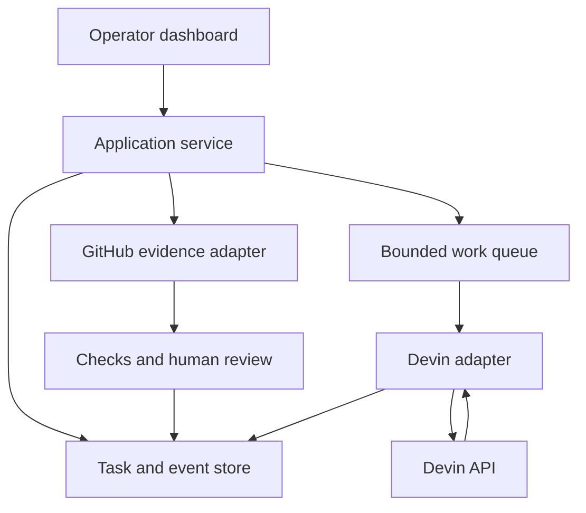

# Architecture

## Scope

The current application is a local demonstration of an operational interface and a small workflow state machine. It does not execute coding tasks, call Devin, inspect a repository, run the displayed checks, or create pull requests. The dashboard labels its sample data accordingly.

## Implemented demo

| Component | Responsibility | Persistence |
| --- | --- | --- |
| Browser UI in `public/` | Search, filter, select a session, inspect evidence, and request demo actions | UI state in the current page |
| Node HTTP server | Serve local assets and a JSON API | None |
| In-memory store | Seed sessions, enforce transitions, and record simulated events | Process lifetime only |
| Automated checks | Exercise the demo's behavior without external credentials | Test fixtures only |

The browser fetches JSON from the same-origin server. Mutations return the updated state for rendering. The current application does not have a provider event stream, durable job queue, database, or multi-user authentication.

### Local API

| Method and path | Meaning |
| --- | --- |
| `GET /api/state` | Read the current demo state |
| `POST /api/tasks` | Add a simulated task using `title` and `repository` |
| `POST /api/sessions/:id/advance` | Advance an eligible simulated session |
| `POST /api/sessions/:id/approve` | Accept a review-ready simulated result |
| `POST /api/sessions/:id/request-changes` | Return a review-ready result for another simulated iteration |
| `POST /api/reset` | Restore the seeded demonstration |

Read responses include `mode`, `updatedAt`, `settings`, and `sessions`. Successful mutations return a `state` object. A session carries its identity, task, repository label, branch, status, progress, illustrative usage, review decision, check summaries, and event history. These are application fields, not an exact copy of the Devin API schema.

### Review semantics

The normal demonstration path is `queued → running → awaiting_approval → completed`. A request for changes returns work to the queue. Budget and concurrency decisions can stop progress. A seeded blocked record illustrates an exception that needs attention.

The application must distinguish these concepts:

| Signal | Interpretation |
| --- | --- |
| Agent has stopped working | Execution state; not proof of correctness |
| Checks passed | Evidence from a named check; simulated in this release |
| Human accepted the result | An application review decision |
| Pull request merged | A separate repository event; not performed by this demo |

Approving the sample result marks only the local session as complete. A live implementation must not treat a dashboard click as permission to bypass branch protection or merge a pull request.

## Proposed live pilot architecture

The following design is **planned**, not implemented:

The application service owns task identity, deduplication, authorization, review decisions, and links between external records. The Devin adapter translates provider responses without inventing missing evidence. The GitHub adapter reads the relevant commit, checks, and review state. A durable store preserves the association between a task, every session attempt, and the exact commit reviewed.

### First live workflow

1. A maintainer selects one permitted issue and records acceptance criteria and a usage boundary.
2. The service records a unique task and dispatch intent before creating one Devin session.
3. The worker observes the session, records provider state and usage, and exposes any blocker.
4. When a proposed change is available, the service links its pull request and commit and collects actual checks.
5. A human reviews the evidence. Requested changes create a traceable iteration; approval records acceptance. Repository merging remains a separate governed operation.

### Adapter boundary

The future adapter should expose application operations such as `createSession`, `getSession`, `sendMessage`, and `terminateSession`. Its output should preserve the raw provider status alongside the application's interpretation. Unsupported capabilities must be explicit; a missing cost field must remain unknown rather than becoming zero.

The proposed initial transport is controlled polling with timeouts and backoff. A later server-sent event channel can distribute normalized updates from the application to browsers. That channel would not imply Devin supplies a native SSE feed. No webhook or streaming availability is assumed.

### Failure handling to implement

| Failure | Required behavior |
| --- | --- |
| Create request times out | Reconcile the recorded dispatch before retrying; avoid duplicate paid sessions |
| Provider returns an authorization error | Stop dispatch and surface a permission problem |
| Provider throttles requests | Back off and keep the last successful observation visibly dated |
| A session exits with incomplete work | Record an incomplete outcome and retain evidence |
| Tests fail or required evidence is absent | Keep the result out of the accepted state |
| A commit changes after approval | Invalidate approval for the old commit and re-evaluate |
| Usage cannot be read | Display unknown usage and suspend additional automatic dispatch as configured |
| Cancellation is requested | Track the request and observed outcome separately; do not claim the provider stopped immediately |

### Access and deployment boundary

The local prototype is not a production control plane. Before shared deployment or a live provider connection, add authenticated operators, authorization on each task, durable audit records, credential storage on the server, request limits, and repository allowlists. Provider credentials must never be placed in browser JavaScript or committed files.

These are planned requirements for executing paid work, not claims that this demo already supplies production protection. Account-specific permissions and billing controls must be validated using the [integration checklist](DEVIN-INTEGRATION.md).
